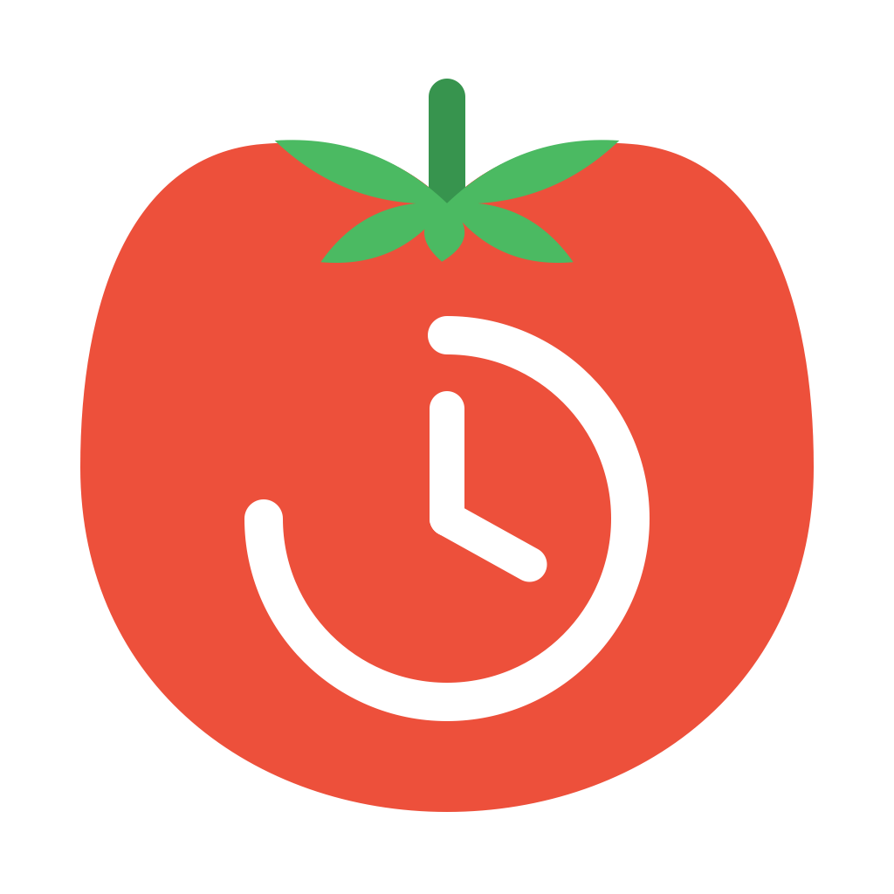
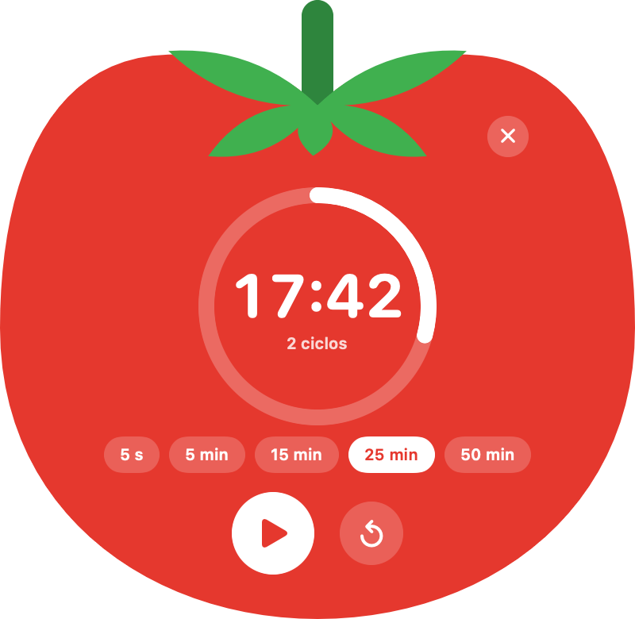
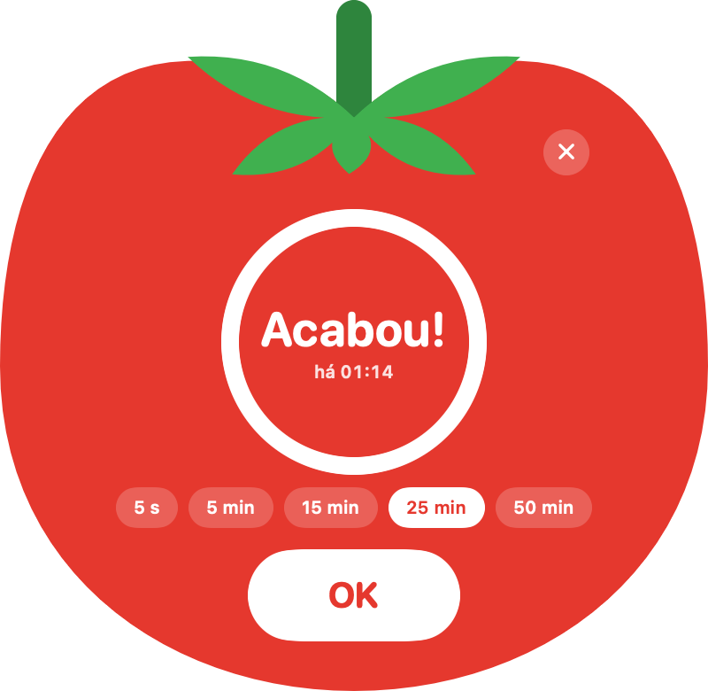

<p align="center"></p>

<h1 align="center">Foco 🍅</h1>

<p align="center">Um timer Pomodoro para macOS em forma de tomate, que mora na barra de menus.</p>

<p align="center">
  
  &nbsp;
  
</p>

## Recursos

- **Janela em forma de tomate** — sem bordas, arrastável, com anel de progresso.
- **Mora na barra de menus** — sem ícone no Dock. O tomate da barra vai *enchendo* conforme o tempo passa, ao lado do tempo restante.
- **Durações**: 5 s (para testar o alarme), 5, 15, 25 e 50 min.
- **Alarme que não deixa passar** quando o tempo acaba:
  - o tomate pula na frente de todas as janelas, na tela onde está o mouse, com um botão **OK**;
  - o som repete a cada 15 s (por até 2 min);
  - o tomate da barra pisca e mostra há quanto tempo acabou (`+03:12`);
  - notificação do macOS, que fica na Central de Notificações.

  Tudo para ao clicar **OK** (na janela, no menu ou na notificação).
- **Abre sozinho ao iniciar o Mac** (só na barra de menus) — dá para desligar no menu.

## Requisitos

- macOS 15 ou mais recente
- Xcode ou Command Line Tools (para o `swiftc`)

## Compilar e instalar

```bash
git clone https://github.com/marcelo-melo/foco.git
cd foco
./build.sh --install   # compila, copia para /Applications e abre
```

Sem `--install`, o app fica em `build/Foco.app`.

Não há projeto do Xcode: o app é compilado direto com `swiftc` e assinado localmente (ad-hoc).

## Estrutura

| Arquivo | O que é |
|---|---|
| `App.swift` | O app (SwiftUI): modelo do timer, alarme, barra de menus e janela |
| `Tomate.swift` | A forma vetorial do tomate, usada no ícone, na janela e na barra |
| `gerador/main.swift` | Gera o ícone do app a partir da forma do tomate |
| `Info.plist` | Configuração do pacote `.app` |
| `build.sh` | Script de build |

## Abrir ao iniciar o Mac

O Foco cria `~/Library/LaunchAgents/com.marcelo.foco.plist`, que abre o app no login com `--login` (só na barra de menus, sem janela). Para desligar, desmarque **Abrir ao iniciar o Mac** no menu do tomate.

## Licença

[MIT](LICENSE)
