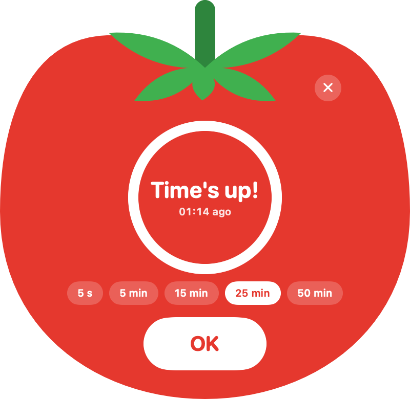

<p align="center"></p>

<h1 align="center">Foco 🍅</h1>

<p align="center">A tomato-shaped Pomodoro timer for macOS that lives in your menu bar.</p>

<p align="center">
  
  &nbsp;
  
</p>

## Features

- **Tomato-shaped window**: borderless and draggable, with a progress ring.
- **Lives in the menu bar**, with no Dock icon. The menu bar tomato *fills up* as time passes, next to the time remaining.
- **Durations**: 5 s (for testing the alarm), 5, 15, 25 and 50 min.
- **An alarm that's hard to miss** when time runs out:
  - the tomato jumps in front of all windows, on the screen where your mouse is, with an **OK** button;
  - the sound repeats every 15 s (for up to 2 min);
  - the menu bar tomato blinks and shows how long ago time ran out (`+03:12`);
  - a macOS notification, which stays in Notification Center.

  Everything stops when you click **OK** (in the window, the menu or the notification).
- **Launches at login** (menu bar only). You can turn this off in the menu.

## Requirements

- macOS 15 or later
- Xcode or the Command Line Tools (for `swiftc`)

## Build and install

```bash
git clone https://github.com/marcelo-melo/foco.git
cd foco
./build.sh --install   # builds, copies to /Applications and launches
```

Without `--install`, the app is left in `build/Foco.app`.

There is no Xcode project: the app is compiled directly with `swiftc` and signed locally (ad-hoc).

## Project layout

| File | What it is |
|---|---|
| `App.swift` | The app (SwiftUI): timer model, alarm, menu bar and window |
| `Tomato.swift` | The vector tomato shape, shared by the icon, the window and the menu bar |
| `icon-generator/main.swift` | Generates the app icon from the tomato shape |
| `Info.plist` | App bundle configuration |
| `build.sh` | Build script |

## Launch at login

Foco creates `~/Library/LaunchAgents/com.marcelo.foco.plist`, which opens the app at login with `--login` (menu bar only, no window). To turn it off, uncheck **Launch at Login** in the tomato menu.

## License

[MIT](LICENSE)
